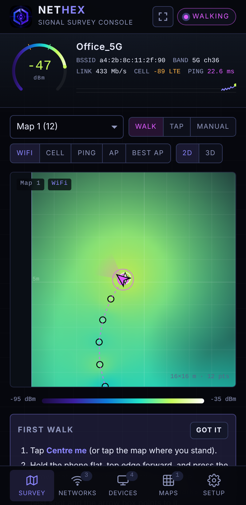
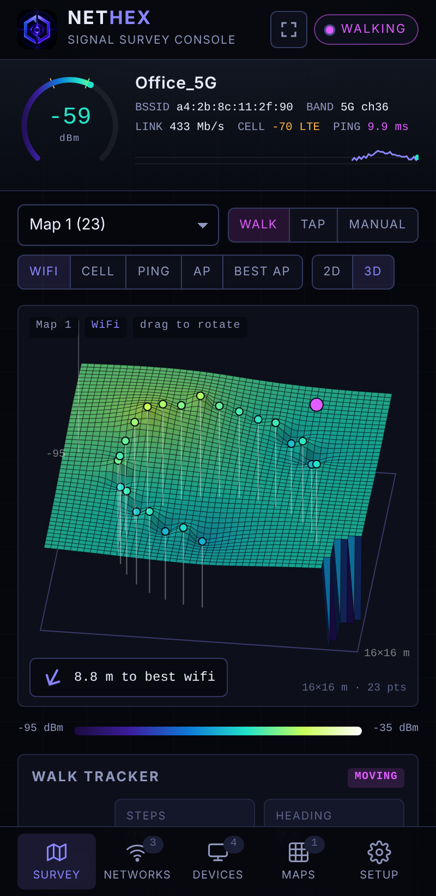
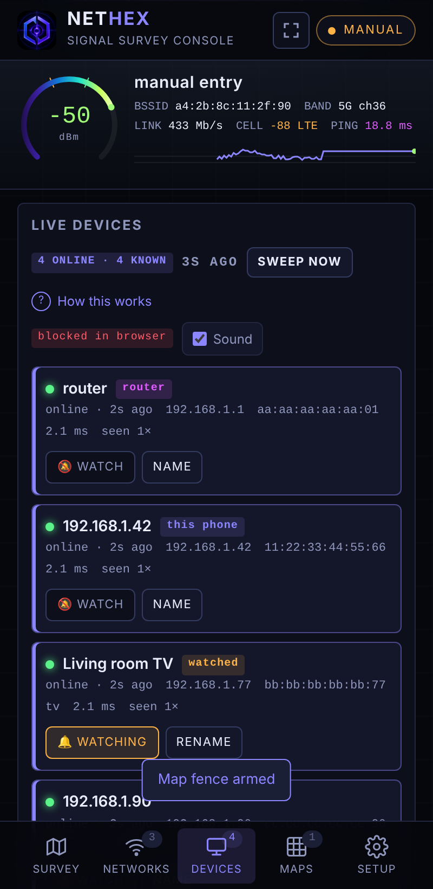

# Nethex

**Walk-tracked WiFi, cell and latency survey for Android, with a live view of who is on your network.**

No root. No cloud. Everything stays on the phone.

  
  
  

## What it does

- **Walk mode**: the phone's step counter and rotation sensor move you across a floor map; a reading logs itself every 0.8 m with WiFi dBm, cell dBm (LTE/NR) and ping to the router. Tap the map to correct drift.
- **Five layers**: WiFi, Cell, Ping, a single access point, or *Best AP* (which AP wins where). 2D heatmap or 3D terrain, four colour scales, value labels, floorplan underlay, replay of the walk.
- **Best spot**: the strongest cell of the current layer is marked ✦ with distance and turn direction from where you stand.
- **Live devices**: every 15 s the app pings the whole /24 and reads the ARP table, which sleeping phones still answer. Name devices, watch them, see joins and leaves.
- **Network fence**: a watched (or any) device that drops off the WiFi raises an Android notification, with the app in the background.
- **Map fence**: a length × breadth rectangle on the map; alerts when *you* step out and when you come back.
- **Motion in path**: RSSI variance detector that notices a body crossing the phone–router path while the phone sits still.
- Multiple maps that grow as you walk past an edge; CSV/JSON export and import.

### What it does not do

A phone cannot locate *other* people or devices. Presence on the network (ARP) is the only signal it has about them, which is why the network fence is presence-based. Positioning of your own phone is dead reckoning; it drifts a little per minute, so tap your true position now and then.

## Install

Download `Nethex.apk` from the [latest release](../../releases/latest), open it on the phone, allow installs from that source. Android 10 or newer.

On first run grant **Location** (WiFi names and scans need it), **Physical activity** (step counter), **Phone** (cell signal) and **Notifications**. Exclude the app from battery optimisation if sweeps stop when the screen is off. Settings for fences, sweep timing and thresholds are in the app and persist.

## How it is built

`app/` is a small Kotlin app: a foreground service runs the sensors, telemetry, presence sweep and an HTTP API on `127.0.0.1:8765`; a WebView shows `app/src/main/assets/phantom.html`, which is the entire UI. The same HTML runs unchanged against the Python listener in `termux/`, so the UI can be developed in a desktop browser.

| File | Role |
|---|---|
| `SpectreService.kt` | Foreground service, notification channels, wake lock |
| `SpectreServer.kt` | HTTP API (NanoHTTPD), same routes as `termux/phantom.py` |
| `Telemetry.kt` | WiFi link, cell dBm, gateway ping, AP scans, motion detector |
| `Tracker.kt` | Dead reckoning from rotation vector + step detector |
| `Presence.kt` | Ping-triggered ARP sweep, join/leave events, names, watch flags, notifications |
| `MainActivity.kt` | Permissions, WebView |
| `assets/phantom.html` | The UI |

### Building

GitHub Actions builds on every push to `main` and attaches the APK to the `latest` release. Nothing to install locally; see `.github/workflows/build.yml`.

Release signing: the workflow restores a keystore from repository secrets `KEYSTORE_B64`, `KEYSTORE_PASSWORD`, `KEY_ALIAS`, `KEY_PASSWORD`. Without them (forks, local builds) the APK is signed with the debug key, which installs fine but will not update over a release-signed install.

To build locally: open the project in Android Studio, or `gradle assembleRelease` with JDK 17 and the Android SDK (API 34).

### Running the UI without the app

`termux/phantom.py` is the original listener for Termux: `pkg install python termux-api`, run `python phantom.py`, open `http://127.0.0.1:8765`. `termux/Termux-Setup-Guide.pdf` has the details. A mock listener for UI work on a desktop is easy to write from the route list at the top of `phantom.py`.

## API (local only)

| Route | Returns |
|---|---|
| `GET /api/track` | position, heading, steps, wifi, cell, net, motion, presence summary |
| `GET /api/scan` | access points the radio can hear |
| `GET /api/devices?since=` | devices, join/leave events, fence config |
| `GET /api/devices/name|watch|forget|sweep` | manage devices |
| `GET /api/presence/config` | fence settings |
| `GET /api/notify` | post an Android notification |
| `GET /api/track/set|face|steplen|reset` | tracker control |

## Privacy

The app makes no network connections except pings inside your own subnet and the WiFi/cell readings Android provides. No analytics, no accounts, no uploads. Survey data lives in the WebView's local storage; export it from Setup to keep a copy.

## Licence

MIT. See `LICENSE`.
